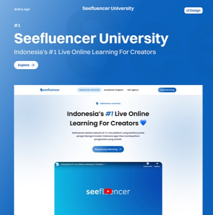
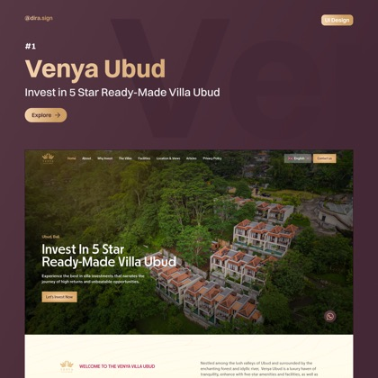
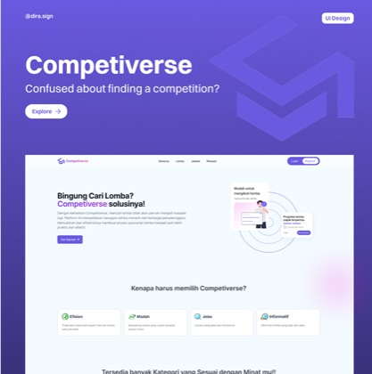
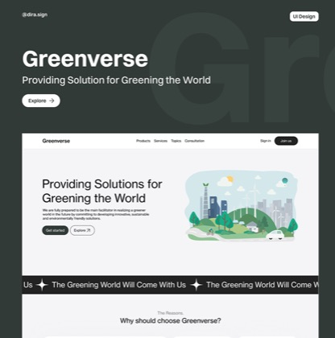
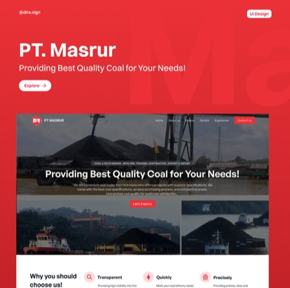
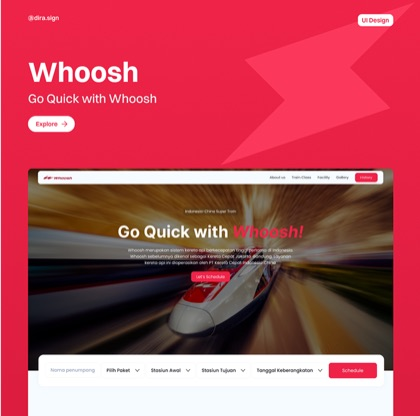

<a href="https://aryadiras.my.id">
<picture>
  <source media="(prefers-color-scheme: dark)" srcset="./assets/header-dark.svg" />
  <source media="(prefers-color-scheme: light)" srcset="./assets/header-light.svg" />
  
</picture>
</a>

  
  
  
  
  
  
  

### 👋 Hey there!

I'm a **UI/UX Designer** who also ships the code. I love the space where design meets engineering: turning a rough idea into a pixel-perfect Figma file, then bringing it to life with smooth, high-performance frontends.

- 🔭 Building internal apps at **adw consulting** and digital invitations at **Abadikan**
- 🎨 Designing websites for clients at **RAF-Studio**
- 🎓 Studying Information Systems at **BINUS University**
- 🏔️ When I'm offline, I'm probably on a mountain. **12 peaks** and counting
- ☕ Manual brew enthusiast, lo-fi on while I build

### 🎨 Featured Work

<table>
  <tr>
    <td align="center" width="33%">
      
       <b>Seefluencer</b>
       Live learning platform for creators
       
    </td>
    <td align="center" width="33%">
      
       <b>Venya Ubud</b>
       5-star villa investment site, Bali
       
    </td>
    <td align="center" width="33%">
      
       <b>Competiverse</b>
       Competition discovery for students
       
    </td>
  </tr>
  <tr>
    <td align="center">
      
       <b>Greenverse</b>
       Greening the world through tech
       
    </td>
    <td align="center">
      
       <b>PT. Masrur</b>
       Company profile website
       
    </td>
    <td align="center">
      
       <b>Whoosh</b>
       Design concept built for speed
       
    </td>
  </tr>
</table>

More case studies on <a href="https://aryadiras.my.id"><b>aryadiras.my.id</b></a> →

### 💼 Experience

| | Role | Where | When |
|:-:|---|---|---|
| 🟢 | **Junior Software Developer** | adw consulting · Contract | Jun 2025 – now |
| 🟢 | **Frontend Engineer** | Abadikan · Part-time | May 2025 – now |
| 🟢 | **Web Designer** | RAF-Studio · Freelance | Jul 2024 – now |
| ⚪ | **Software Developer Intern** | adw consulting | May 2024 – May 2025 |

### 🛠️ Tech Stack

### 📊 GitHub Stats

  
  

<picture>
  <source media="(prefers-color-scheme: dark)" srcset="https://raw.githubusercontent.com/aryadira/aryadira/output/github-snake-dark.svg" />
  <source media="(prefers-color-scheme: light)" srcset="https://raw.githubusercontent.com/aryadira/aryadira/output/github-snake.svg" />
  
</picture>

<i>Looking for a designer & developer? <a href="mailto:abadikanid@gmail.com">Let's build something amazing.</a> ✨</i>

